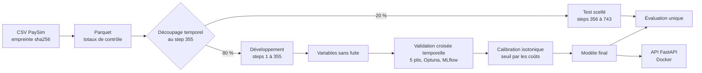

# Détection de fraude mobile money


Modèle de détection de fraude sur **6,3 millions de transactions mobile money** simulées (jeu de données PaySim), construit avec une méthode d'évaluation stricte : découpage dans l'ordre du temps, jeu de test scellé et ouvert une seule fois, aucune variable qui laisse fuiter la réponse, probabilités calibrées et seuil de décision fixé par les coûts.

## Résultats sur le jeu de test

Le jeu de test couvre les 16 derniers jours de la simulation (1 248 736 transactions, 4 250 fraudes). Il n'a été utilisé qu'une seule fois, après tous les choix de modélisation.

| | Tout le test | Période chargée | Période calme |
|---|---|---|---|
| Fraudes | 4 250 | 626 | 3 624 |
| PR-AUC (hasard) | **0,539** (0,003) | 0,497 (0,0007) | 0,576 (0,010) |
| Fraudes détectées (rappel) | **69 %** | 67 % | 70 % |
| Montant fraudé détecté | **97 %** | 97 % | 97 % |
| Précision des alertes | 19 % | 5 % | 33 % |
| Réduction du coût total | **96 %** | 93 % | 96 % |

- La règle d'alerte vise d'abord les grosses fraudes : 69 % des fraudes sont détectées, mais elles représentent **97 % de l'argent fraudé**.
- Le coût total (fraudes ratées + vérifications) passe de 6,68 milliards à 272 millions.
- La conclusion est **robuste au coût choisi** pour une vérification : réduction de 87 % à 98 % entre 1 000 et 50 000.
- La précision varie avec le taux de fraude de la période, pas avec la qualité du modèle : c'est pourquoi les résultats sont présentés par période.

## Méthode



1. **Cadrage avant les données** : question, information disponible au moment de la décision, coût des erreurs, métriques. L'exactitude (*accuracy*) est écartée : avec 0,13 % de fraudes, un modèle qui ne signale jamais rien aurait 99,87 % d'exactitude.
2. **Données brutes intactes** : empreinte sha256 du fichier, conversion en Parquet vérifiée ligne par ligne.
3. **Découpage dans l'ordre du temps** : 80 % des transactions pour le développement, 20 % pour le test, coupure entre deux heures. Le test est mis en lecture seule et son empreinte est enregistrée.
4. **Pas de fuite de données** : les quatre colonnes de soldes sont exclues. Elles séparent presque parfaitement les fraudes (98 % des fraudes vident le compte, 0 % des transactions normales), mais la documentation indique qu'elles ont été modifiées après la détection. Les modèles publiés sur ce jeu de données avec des scores proches de 0,99 les utilisent presque tous.
5. **Variables connues au moment de la transaction** : type, heure, montant, historique du destinataire et de l'émetteur calculé jusqu'à l'heure précédente.
6. **Périmètre** : sur le développement, 100 % des fraudes sont des TRANSFER ou des CASH_OUT. Le modèle ne traite que ces deux types, mais l'évaluation porte sur **tout** le test : une fraude d'un autre type compterait comme ratée.
7. **Réglage des hyperparamètres** par validation croisée temporelle (5 plis, entraînement sur le passé, validation sur la période suivante) avec Optuna, 25 essais suivis dans MLflow.

   | Modèle | PR-AUC moyenne (5 plis) | Écart-type |
   |---|---|---|
   | Régression logistique (référence) | 0,105 | 0,081 |
   | LightGBM réglé | **0,406** | **0,029** |

8. **Calibration** des probabilités (régression isotonique) vérifiée sur une période non vue : score de Brier de 0,001121 à 0,000978.
9. **Décision par les coûts** : alerter si probabilité × montant ≥ coût d'une vérification (5 000), avec analyse de sensibilité.
10. **Évaluation finale unique** sur le test, globale et par période.

Toutes les hypothèses, vérifications et décisions sont datées dans le [journal du projet](docs/journal.md).

## Limites

- **Données simulées.** La variable la plus utile est l'heure : le simulateur répartit les fraudes uniformément sur 24 heures alors que l'activité normale suit le rythme de la journée. Un fraudeur réel ne se comporterait pas forcément ainsi. Le plafond de 10 millions par fraude est aussi un artefact du simulateur.
- **Changement du taux de fraude.** Il passe de 0,077 % sur le développement à 0,34 % sur le test. Les probabilités sont bien calibrées en période chargée, mais sous-estimées d'environ 2 fois en période calme.
- **Historique des comptes.** L'API reçoit les compteurs d'historique dans la requête ; en production, ils seraient tenus à jour par une base de données.
- **Probabilités extrêmes.** Le palier supérieur de la calibration peut afficher 100 % : à interpréter comme un risque très élevé, pas comme une certitude.
- **Hyperparamètres.** Le meilleur nombre d'arbres est à la limite basse de l'intervalle exploré. Le plateau des résultats (0,39 à 0,41 sur les derniers essais) laisse attendre un gain faible d'un intervalle élargi.

## Utiliser l'API

```bash
docker build -t fraude-mobile-money-api .
docker run -d -p 8000:8000 fraude-mobile-money-api
curl -X POST http://localhost:8000/predire -H "Content-Type: application/json" \
  -d '{"type":"TRANSFER","step":4,"montant":10000000,"orig_nb_avant":0,"dest_nb_avant":0,"dest_nb_24h":0,"dest_montant_avant":0}'
```

Documentation interactive : http://localhost:8000/docs

Un test automatique vérifie que l'API calcule les variables **exactement** comme le code d'entraînement (SQL), pour éviter un écart silencieux entre entraînement et production.

## Reproduire le projet

Prérequis : [uv](https://docs.astral.sh/uv/), un compte Kaggle et Docker.

```bash
git clone https://github.com/onelngoma-source/fraude-mobile-money.git
cd fraude-mobile-money
uv sync
uv run kaggle datasets download ealaxi/paysim1 -p data/raw --unzip
uv run python scripts/convertir_parquet.py
uv run python scripts/decouper_dev_test.py
uv run python scripts/construire_variables.py
uv run python scripts/entrainer_base.py
uv run python scripts/optimiser_lightgbm.py
uv run python scripts/calibrer_et_seuil.py
uv run python scripts/evaluer_test.py
uv run pytest
uv run --group demo streamlit run app/demo.py
```

## Structure

```
fraude-mobile-money/
├── app/                        # Démo Streamlit
├── docs/journal.md             # Hypothèses, décisions et résultats datés
├── models/modele_final.joblib  # Modèle LightGBM et calibration
├── notebooks/                  # Contrôle qualité et exploration
├── reports/                    # Résultats de validation et évaluation finale
├── scripts/                    # Pipeline : conversion, découpage, variables, modèles, évaluation
├── src/fraude_mobile_money/    # Prédiction et API FastAPI
├── tests/                      # Tests pytest
└── Dockerfile                  # Image de l'API
```

## Auteur

**Onel NGOMA**, étudiant en Big Data et Intelligence Artificielle, Libreville.
GitHub : [onelngoma-source](https://github.com/onelngoma-source)

Données : [PaySim](https://www.kaggle.com/datasets/ealaxi/paysim1), E. A. Lopez-Rojas, licence CC BY-SA 4.0.
